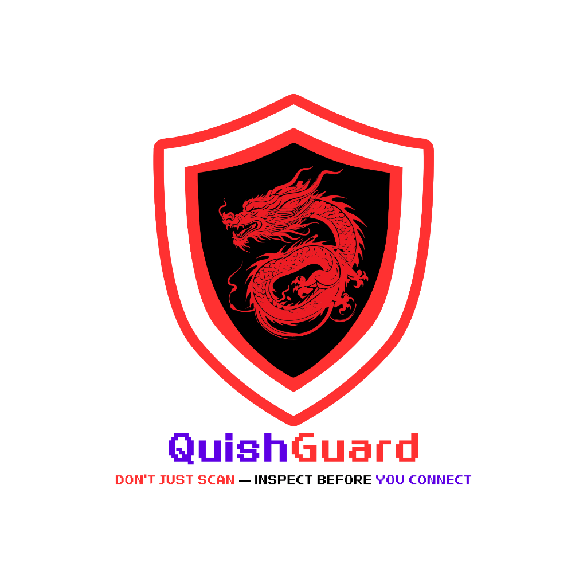
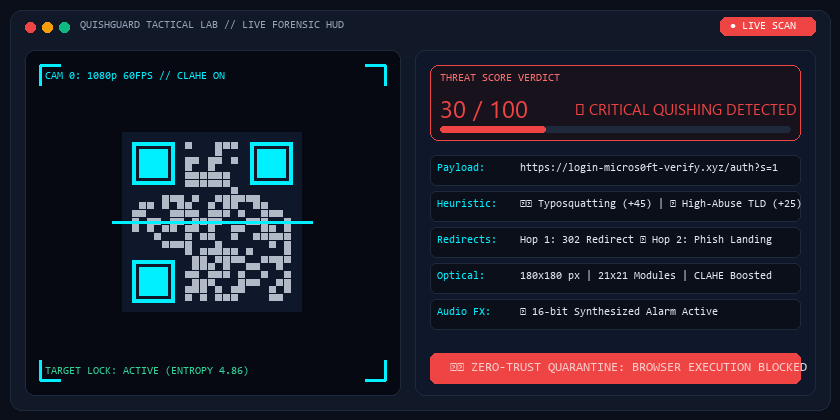

<div align="center">
  
  <br/><br/>
  <h1>🛡️ QuishGuard Desktop v2.0 Enterprise</h1>
  
  <p align="center">
    <a href="https://github.com/Rohanjm911/QuishGuard">
      
    </a>
  </p>

  <p><em>Enterprise-Grade, 100% Offline QR Code Quarantine &amp; Anti-Quishing Telemetry Tool</em></p>
  
  <p>
    
    
    
    
    
  </p>
</div>

---

## 🎯 Overview
Malicious QR codes deployed in corporate phishing emails, social engineering drops, and physical spaces routinely circumvent secure email gateways (SEGs) and corporate perimeter firewalls. Blindly scanning them on mobile devices exposes corporate single-sign-on (SSO) credentials, session tokens, and endpoint devices to drive-by exploits.

**QuishGuard Desktop** functions as an air-gapped, zero-trust quarantine workstation tool. Analysts and end users can inspect, deconstruct, and verify QR images via local file selection or a real-time tactical camera HUD before any browser or mobile endpoint interacts with the payload.

---

## ⚡ Live Tactical Quarantine Demonstration

<div align="center">
  
  <p><em>Real-Time Optical Matrix Locking, Sweeping Laser Scanline &amp; Instantaneous Heuristic Threat Evaluation</em></p>
</div>

---

## ✨ Key Feature Highlights

### 1. 🔍 Multi-Engine QR Decoding & Optical Diagnostics
- **Dual-Engine Decoding**: Primary decoding through `pyzbar` with seamless fallback to an OpenCV multi-pass pipeline (Grayscale transformation, CLAHE contrast enhancement, and adaptive Gaussian thresholding).
- **Physical Optical Metrics**: Analyzes pixel dimensions, matrix grid resolution, file format, and file size.
- **Cryptographic Chain of Custody**: Computes instantaneous cryptographic SHA-256 hashes of decoded payload strings.
- **Shannon Information Entropy**: Calculates per-symbol bit entropy ($H(X)$) to flag encoded tokens, compressed payloads, and randomized phishing hashes.

### 2. 📹 Tactical High-Resolution Camera Scanner
- **High-Definition Stream**: Runs at 720p/1080p sensor resolution for sharp detection of dense QR codes.
- **Cyber Viewfinder HUD**: Neon targeting reticle, center crosshair, and animated sweeping laser scanline.
- **Visual Matrix Lock**: Automatically snaps a neon bounding polygon around recognized QR matrices and captures the image directly into the dashboard.
- **Camera Controls Bar**:
  - `🔄 Switch Camera`: Seamlessly cycles between multiple connected USB webcams or virtual capture devices.
  - `✨ Screen / Low-Light Boost`: Toggles CLAHE contrast enhancement to eliminate glare from mobile/laptop screens and improve scanning in dim environments.
  - `📸 Snapshot & Scan`: Captures an instant freeze-frame for deep inspection when dealing with shaky video feeds.
  - `❌ Close Camera`: Safely releases video streams and camera threads.

### 3. 🔬 Interactive Payload Sandbox & De-Obfuscation Inspector
- **Wireshark-Style Raw Byte Hex Dump**: Displays 16-byte memory offsets (`00000000: 75 70 69 ... |ascii|`) with a 1-click `📋 Copy Hex Dump` action.
- **Automated De-Obfuscation**: Identifies and decodes URL percent-encoding (`%20`, `%3F`, etc.) and unpacks nested Base64 strings.
- **Mobile OS Intent Sandbox**: Scans payloads for dangerous Android/iOS deep links (`intent://`, `market://`, direct `.apk` downloads, custom URL schemes) and alerts analysts to unauthorized execution attempts.

### 4. 💳 Dedicated UPI Payment Safety Engine
- Deconstructs Indian Unified Payments Interface (`upi://pay`) QR codes.
- Validates Virtual Payment Addresses (VPA) and payee handles (`@okhdfcbank`, `@paytm`, `@ybl`, etc.).
- Flags zero-amount dynamic charge requests, unverified merchant IDs (`mc`), and deceptive display names.

### 5. 🌐 Safe Headless HTTP Hop Tracer
- Recursively audits HTTP redirect chains up to 5 hops without browser execution.
- Employs legitimate enterprise browser `User-Agent` headers.
- Captures hop-by-hop HTTP status codes, redirection destinations, SSL exception isolation, and loop mitigation.

### 6. 🧠 Offline Heuristic Phishing Engine
- **Typosquatting & Impersonation**: Levenshtein-distance comparison against 30+ high-value corporate targets (`google`, `microsoft`, `paypal`, `amazon`, `binance`, `sbi`, etc.).
- **Raw IP Address Targets**: Flags direct IPv4 and IPv6 URL hosts.
- **Basic Auth Obfuscation**: Intercepts credential injection schemes (`https://legit.com@phishing-server.com`).
- **High-Abuse Disposable TLDs**: Flags high-risk top-level domains (`.xyz`, `.top`, `.buzz`, `.ru`, `.icu`, `.tk`, etc.).
- **Subdomain Nesting**: Detects multi-level subdomain masquerading.

### 7. 🗄️ Searchable Audit Log & Historical Telemetry
- **Local Persistence**: Retains all quarantine scans in a local JSON database (`scan_history.json`).
- **Live Search Filtering**: Search records as you type by URL, UPI ID, domain, or SHA-256 fingerprint.
- **Segmented Risk Filters**: Filter instantly by `All`, `🚨 Critical`, `⚠️ Suspicious`, or `🛡️ Clean`.
- **1-Click Reload**: Click `👁️ Load Scan` on any past record to instantly restore the full dashboard, vector graphs, and dossier.
- **SIEM & SOC Export**: Export entire historical logs to `.csv` or machine-readable `.json`.

### 8. 📄 Self-Contained Forensic Incident Reports
- **Publication-Grade HTML Export**: Click `📄 Export Report` to generate a branded, self-contained forensic incident dossier with base64 embedded QR thumbnail.
- **Print to PDF**: Fully optimized with `@media print` CSS for instant export to PDF via `Ctrl + P` in any browser.

### 9. 🔊 Tactical Windows Cyber Audio Synthesis & Sound FX Studio
- **16-bit 44.1kHz In-Memory PCM WAV Synthesis**: Pure Python zero-dependency acoustic feedback inspired by Apple & Google sound design.
- **7 Tactical Profiles**:
  - `🛡️ Verified Clean QR`: Apple Pay & Google Pay ascending major triad chord (`C6 → E6 → G6`).
  - `⚠️ Suspicious Caution`: Apple macOS amber dual-bell chime (`A5 → F5`).
  - `🚨 Critical Quarantine Alarm`: High-tech minor dissonance security warble (`440Hz + 466Hz + 180Hz sub`).
  - `🎯 Biometric Matrix Lock`: Apple FaceID / optical laser chirp sweep (`1850Hz → 2800Hz`).
  - `📷 Optical Shutter Snap`: Tactile camera aperture click on scan trigger.
  - `📄 AirDrop Export Chime`: Ascending completion bell (`E5 → B5 → E6`).
  - `🔘 Tactile Glass Tap`: Apple iOS glass micro-tap for buttons, copies, and switches.
- **Interactive Audio Studio**: Header bar includes a dedicated `🎵 Sound FX` button with a real-time preview audition panel and 1-click `🔊 Audio: ON / 🔇 Audio: OFF` toggle.

---

## 📂 Project Architecture

```text
QuishGuard/
├── requirements.txt            # Pinned Python package dependencies
├── build_exe.bat               # Windows PyInstaller automated one-click build script
├── README.md                   # Enterprise technical manual & architecture reference
├── HOW_TO_RUN.md               # User guide for running the EXE or Python code
├── main.py                     # Main CustomTkinter UI & async worker orchestrator
├── scan_history.json           # Local persistent audit log database (auto-generated)
└── modules/
    ├── __init__.py             # Package init
    ├── qr_engine.py            # Dual-engine QR decoder, CLAHE booster & camera pipeline
    ├── network_tracer.py       # Safe headless HTTP redirect tracer & hop auditor
    ├── heuristics.py           # Typosquatting, IP check, suspicious TLD detection
    ├── sound_manager.py        # Windows native audio synthesizer & mute controller
    ├── report_generator.py     # Self-contained forensic HTML/PDF report generator
    ├── history_manager.py      # Persistent audit log manager with CSV/JSON exporters
    └── ui_widgets.py           # ThreatArcGauge, HopChain, VectorBarChart, ThreatAreaChart,
                                # Dossier, HexPayloadSandbox & ScanHistoryAuditView
```

---

## 🚀 Installation & Local Execution

### Prerequisites
- Windows 10/11 (or Linux/macOS)
- Python 3.10 or higher

### 1. Install Dependencies
```bash
pip install -r requirements.txt
```

### 2. Launch Application
```bash
python main.py
```

---

## 📦 Standalone Windows Executable (`.exe`)

QuishGuard can be distributed as a single, zero-dependency standalone Windows executable that runs out-of-the-box without requiring Python or external packages to be installed on target endpoints:

| Artifact Property | Value |
|---|---|
| **Compilation Status** | ✅ **Pre-Compiled & Ready to Deploy** |
| **Output Binary** | `QuishGuard.exe` |
| **Binary Size** | **83.8 MB** (Self-contained single file) |
| **Executable Location** | `dist/QuishGuard.exe` |
| **Launch Command** | `.\dist\QuishGuard.exe` |
| **Documentation Guide** | [HOW_TO_RUN.md](HOW_TO_RUN.md) |

### How to Run the Compiled Binary
Simply double-click `dist/QuishGuard.exe` in Windows File Explorer, or execute via PowerShell:
```powershell
.\dist\QuishGuard.exe
```

### How to Rebuild After Code Changes
To re-compile the single-file binary after modifying heuristics, modules, or assets:
1. Double-click **`build_exe.bat`** or run in PowerShell:
```powershell
.\build_exe.bat
```
Alternatively, compile directly with PyInstaller using the project spec file:
```powershell
python -m PyInstaller --clean QuishGuard.spec
```

---

## 🔍 Threat Scoring Methodology

The deterministic heuristic engine calculates a unified threat score from 0 to 100:

| Detection Rule | Risk Weight | Security Description |
| :--- | :--- | :--- |
| **Typosquatting** | `+45` | Levenshtein edit distance 1–2 from monitored enterprise brands |
| **Raw IP Host** | `+35` | Destination host is an explicit IPv4 or IPv6 address |
| **Basic Auth Spoof** | `+30` | `user:pass@domain` format masking the true landing host |
| **High-Abuse TLD** | `+25` | Top-level domain strongly associated with automated phishing |
| **Deep Redirect Hop** | `+15` | Redirect chain depth exceeds 2 intermediate hops |
| **Excessive Subdomains** | `+10` | More than 3 nested subdomain dot-levels |

### Threat Verdict Levels
- 🟢 **LOW (0 - 24)**: Clean profile, no suspicious indicators detected.
- 🟡 **MEDIUM (25 - 59)**: Suspicious characteristics detected; manual review advised.
- 🔴 **CRITICAL (60 - 100)**: Severe quishing threat identified. Payload quarantined.

---

## 📋 Comprehensive UI Tabs Reference

| Tab Name | Description | Key User Actions |
| :--- | :--- | :--- |
| **🔍 Detailed QR Analysis** | Optical forensics, SHA-256 hash, entropy, Zero-Trust checklist | `📋 Copy Dossier`, `📄 Export HTML Report`, `🌐 Open Target Safely` |
| **🔬 Payload Sandbox** | Memory-offset hex dump, URL & Base64 de-obfuscation, Mobile Intent audit | `📋 Copy Hex Dump` |
| **Visual Redirect Chain** | Step-by-step interactive hop trajectory graph with latency and HTTP status | Visual inspection of hops |
| **📊 Risk Vector Graph** | Categorical attack surface risk distribution (TLD, Brand, Auth, Hops, Subdomains) | Visual telemetry |
| **📈 Threat Analytics** | Continuous session threat trend spline area chart with live session KPIs | Visual telemetry |
| **🗄️ Scan History** | Searchable audit table with live search input and risk category filter buttons | `👁️ Load Scan`, `📋 Copy Payload`, `📥 Export CSV`, `📥 Export JSON`, `🗑️ Clear History` |
| **Heuristic Flags** | Breakdown of all triggered heuristic rules and risk weights | `📋 Copy Flags` |
| **Live Security Log** | Real-time internal event stream of all scanner actions | `📋 Copy Log`, `🗑️ Clear Log` |

---

## 🎨 Official Brand Emblem

<div align="center">
  
  <br /><br />
  <p><strong>Official Enterprise Dragon Shield</strong><br />
  <em>Battle-tested Zero-Trust quarantine defense mark representing impenetrable offline QR code payload isolation.</em></p>
</div>

---

## 🛡️ License & Compliance
This software is provided for cybersecurity defense, enterprise quarantine workstations, and forensic analysis. Fully offline operation guarantees complete data privacy—no QR payload or telemetry leaves your local network.
